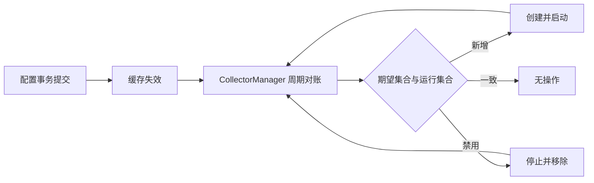

# AU P0 可靠性修复设计

日期：2026-07-29\
状态：方案已批准，待书面规格复核\
基准：`main` / `f034ba55fc5dbf671319fb88f9f511044bca78ac`

## 1. 背景

AU 的当前产品目标是建设“可信贵金属价格底座 + 看盘、分析、提醒任务工具箱”。现有代码已具备多源采集、价格存储、分析、提醒和数据源管理能力，但三处后端行为会直接削弱“可信”：

1. 管理端更新数据源启用状态后，运行中的 `CollectorManager` 不会启动或停止对应采集器。
2. 真实采集错误和数据库写入错误可能被吞掉，并被基类记为成功，导致失败统计和指数退避失效。
3. 数据源当前配置和历史记录分开提交；任一步骤失败都可能留下部分更新，接口仍可能返回成功。

本轮只修复这三个 P0 问题。

## 2. 目标

实施完成后，系统必须满足以下条件：

- 管理员启用或禁用数据源后，在数据库访问和采集器生命周期调用未超时的正常运行条件下，单进程实例以 60 秒为收敛目标，无需重启。
- 重复执行同一配置不会重复启动采集线程或重复停止采集器。
- 采集完全失败或数据库写入失败会增加失败计数，并进入既有指数退避路径。
- 部分数据源请求成功时，系统仍保存有效记录；只有零条请求成功时，整轮采集才失败。
- 数据源当前配置和历史记录在同一事务中提交；任一写入失败时全部回滚。
- 管理接口不再把内部存储失败报告为成功。
- 不改变成功响应的公开结构，不引入数据库结构迁移。

## 3. 非目标

以下中优先级问题不在本轮修改范围内：

- React 提醒页与后端渠道、SSE 契约不一致
- SSE 只重连一次
- `/api/health` 未检查数据库和采集新鲜度
- Umami `unit_switch` 埋点失效
- 管理接口把字符串 `"false"` 转成 `True`
- 提醒接口未校验 `op`
- 双前端路线收敛
- Python 3.9 类型注解和既有 Ruff 告警

如果实施中发现这些问题阻塞 P0 验证，只记录为已知问题，不顺带扩大修改范围。

## 4. 方案选择

采用进程内、线程安全的运行集合对账方案。该方案保留当前 Flask、MySQL 和线程采集架构，不要求运维重启，也不提前引入独立调度服务。

未采用的方案：

- 配置变更后要求重启：实现简单，但管理接口不能兑现“约 60 秒内生效”的承诺。
- 拆分独立调度服务：长期方向合理，但会同时引入进程编排、状态共享和部署迁移，超出本轮范围。

## 5. 设计

### 5.1 采集器运行集合对账

`CollectorManager` 成为采集器生命周期的唯一所有者。内部以 `source_id` 为键保存运行实例，并用同一把锁保护实例表和对账操作。

管理器新增一个可独立测试的单次对账入口。每次对账执行以下步骤：

1. 失效或刷新数据源配置缓存。
2. 读取当前应启用的数据源集合。
3. 计算应启用但尚未运行的集合。
4. 计算正在运行但已被禁用的集合。
5. 为新增集合创建并启动实例。
6. 停止禁用集合，确认生命周期方法返回后再从运行表移除。

`start_all()` 先执行一次对账，再启动后台对账循环。循环间隔默认为 30 秒，为 60 秒收敛目标预留配置刷新和启停耗时，并允许测试注入较短间隔。`stop_all()` 先阻止新的对账，再停止并回收所有运行实例。

同一 `source_id` 同时最多有一个运行实例。连续对账相同配置时不产生生命周期调用。启动新实例失败时，管理器记录错误，但不把失败实例加入运行表，也不影响其他已运行采集器。停止失败时，管理器记录错误，并保留足够状态供下一轮重试，避免误报为已停用。

管理 API 写入配置后继续失效缓存；后台对账负责在最多一个周期内落实变更。API 的成功只表示配置事务已提交，不表示线程已经完成启停。

### 5.2 采集失败语义与退避

本轮不引入大型结果框架。各层遵守一个简单规则：只有预期且可接受的“本轮无新记录”可以正常返回；网络、解析和持久化失败必须向调用方传播。

具体行为如下：

- `BaseCollector` 只在 `fetch()` 完成且所有写入完成后调用 `record_success()`。
- `fetch()` 抛出的异常或写入层抛出的异常统一进入既有失败路径，调用 `record_failure()` 并计算指数退避。
- `GoldAPICollector` 可以保留单个上游请求的容错。至少一个请求成功时返回有效记录；所有请求失败时抛出采集异常。
- 汇率和 Fawaz 采集器不再把网络、解析或写入异常转换为空列表。业务上确实没有价格记录时可以正常返回空列表。
- `PriceWriter` 可以记录数据库异常，但记录后必须重新抛出，不能让调度层误记成功。
- 失败日志保留来源、阶段和异常信息；不记录 Token、完整请求凭据或敏感配置。

“成功但无新记录”不会自动视为故障，因为部分采集器通过副作用更新汇率或其他表。每个采集器必须明确区分正常空结果和异常空结果。

### 5.3 数据源配置事务

数据访问层不再把未知数据库异常静默转换为空列表或 `None`。异常向路由层传播，由 Flask 的统一错误处理返回 5xx。

数据源配置更新在一个连接和一个事务中完成：

1. 查询更新前配置。
2. 更新或插入当前配置。
3. 插入配置历史记录。
4. 查询更新后配置。
5. 提交事务。

任一步骤抛出异常时，事务回滚并重新抛出。路由只有在取得有效的更新后记录时才返回 200；提交失败、历史写入失败或更新后无法读回目标记录时均返回内部错误。

通用事务上下文必须对异常执行回滚，不得在异常路径提交。成功路径仍只提交一次。

### 5.4 并发与关闭

- 只允许一个对账操作修改运行实例表。
- 对账循环必须可被关闭事件及时唤醒，避免应用关闭时额外等待完整的 30 秒。
- `stop_all()` 可重复调用；第二次调用不再停止已回收实例。
- 管理器关闭后不得启动新实例。
- 测试不依赖真实等待，通过注入间隔、事件或直接调用单次对账验证行为。

### 5.5 兼容性

成功请求的 JSON 结构和数据库表结构保持不变。可观察行为只有两类变化：

- 已提交的数据源启停配置会在运行进程中生效。
- 过去被伪装为空数据或成功的内部错误会成为失败统计、退避或 HTTP 5xx。

这些变化修正了错误契约，不提供兼容开关。

## 6. 测试策略

实施采用测试驱动开发。每组行为先添加失败测试，再做最小实现。

### 6.1 `CollectorManager`

- 初始启用的数据源只启动一次。
- 运行中启用新数据源会创建并启动一次。
- 运行中禁用数据源会停止并移除一次。
- 相同配置连续对账不产生额外启停。
- 启动失败不会污染运行集合，下一轮可以重试。
- 停止失败不会被误记为已停止，下一轮可以重试。
- `stop_all()` 能终止对账循环并回收全部实例。

### 6.2 采集器和写入层

- 单个上游失败、其他上游成功时保存有效记录并记为成功。
- 所有上游失败时抛出异常、增加失败计数并使用退避间隔。
- 汇率和 Fawaz 的真实请求或解析失败不会返回正常空结果。
- 批量和单条数据库写入失败都会传播到 `BaseCollector`。
- 成功但无新记录的明确业务路径仍可记为成功。

### 6.3 配置事务和 API

- 当前配置与历史记录在同一事务内只提交一次。
- 历史记录写入失败时当前配置回滚。
- 更新后读回失败时事务不返回成功结果。
- 数据库异常到达 API 时返回 5xx。
- 正常更新保持现有成功响应。

### 6.4 回归验证

- 运行全部 Python 单元测试。
- 运行与改动文件相关的 Ruff 检查。
- 运行 RTM 追踪检查。
- 用定点 Flask 探针确认事务失败不再返回 200。

仓库当前全量 Ruff 已知存在与本轮无关的 `src/routes/api/price_routes.py` 未使用 `pytz` 告警；本轮不以清除此既有告警为完成条件。

## 7. 实施边界

预计修改集中在以下区域：

- `src/collectors/manager.py`
- `src/collectors/base.py`
- `src/collectors/gold_api.py`
- `src/collectors/exchange_rate.py`
- `src/collectors/fawazahmed0.py`
- `src/db/base.py`
- `src/db/price_writer.py`
- `src/db/admin_store.py`
- `src/routes/api/admin_routes.py`
- 对应的 Python 测试

实现可添加小型领域异常或采集器工厂辅助函数，但不得引入新服务、消息队列、数据库迁移或前端修改。

## 8. 交付与回滚

本轮不包含自动部署。代码合并后需要重启现有进程一次，以加载新的管理器实现；此后的启停配置无需重启。

回滚只需恢复本轮代码并重启进程，不需要回滚数据结构。已写入的数据源配置和历史记录保持可读。

## 9. 验收标准

满足以下全部条件后，P0 修复才可交付：

- 新增的生命周期、失败传播和事务测试全部通过。
- 既有 Python 测试全部通过。
- 改动文件通过 Ruff。
- RTM 检查通过。
- 代码审阅确认没有重复线程、关闭竞态、异常吞噬或部分事务提交。
- 书面说明列出未纳入本轮的既有问题，不将其误报为已修复。
